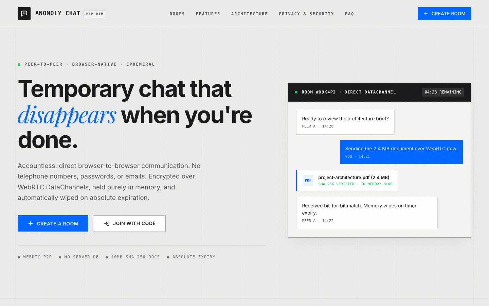
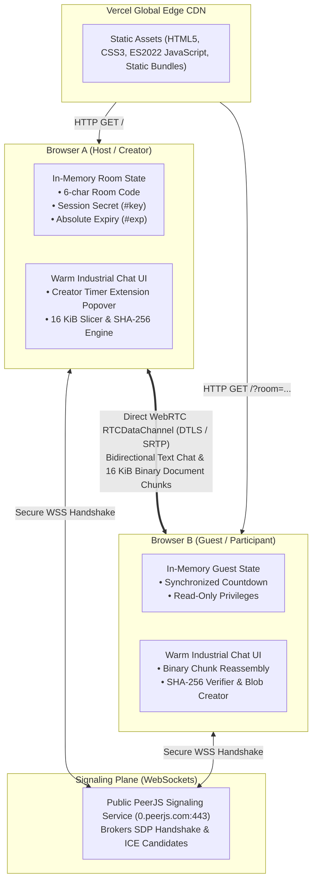
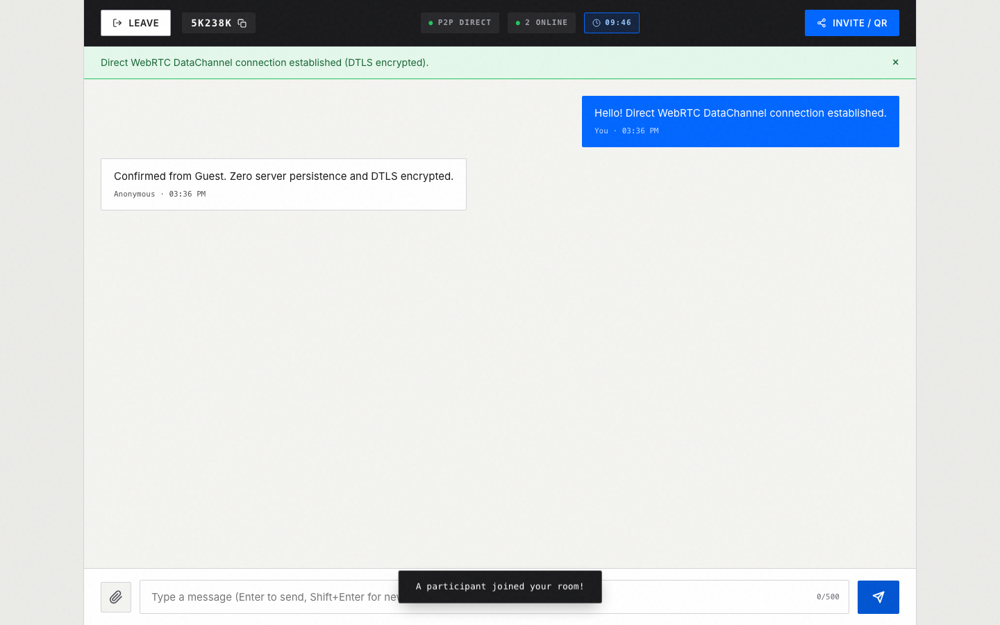
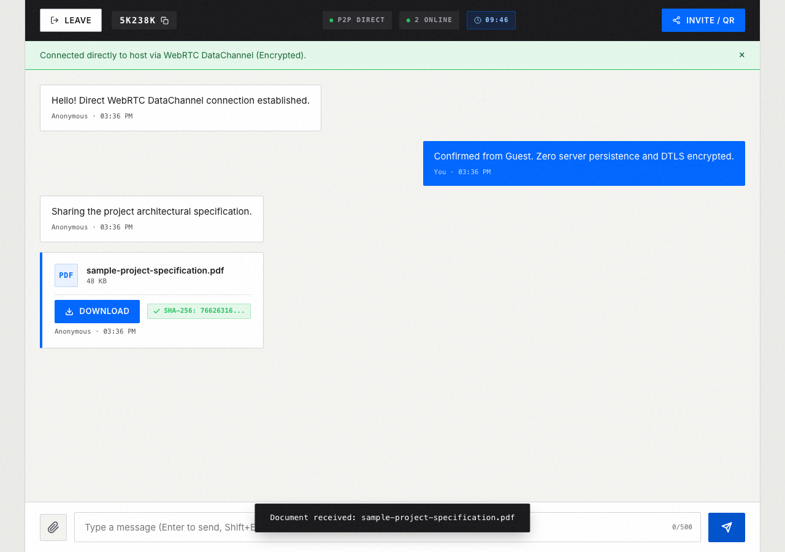
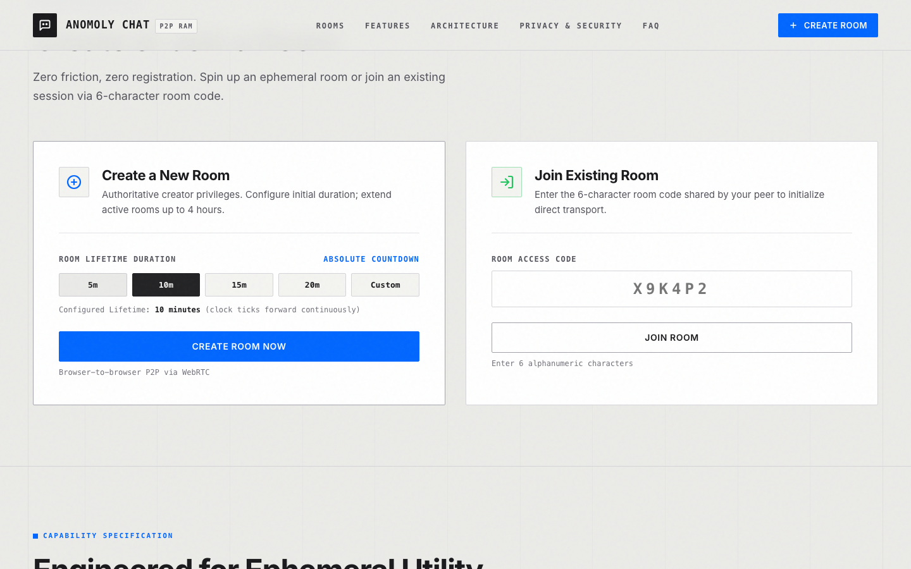
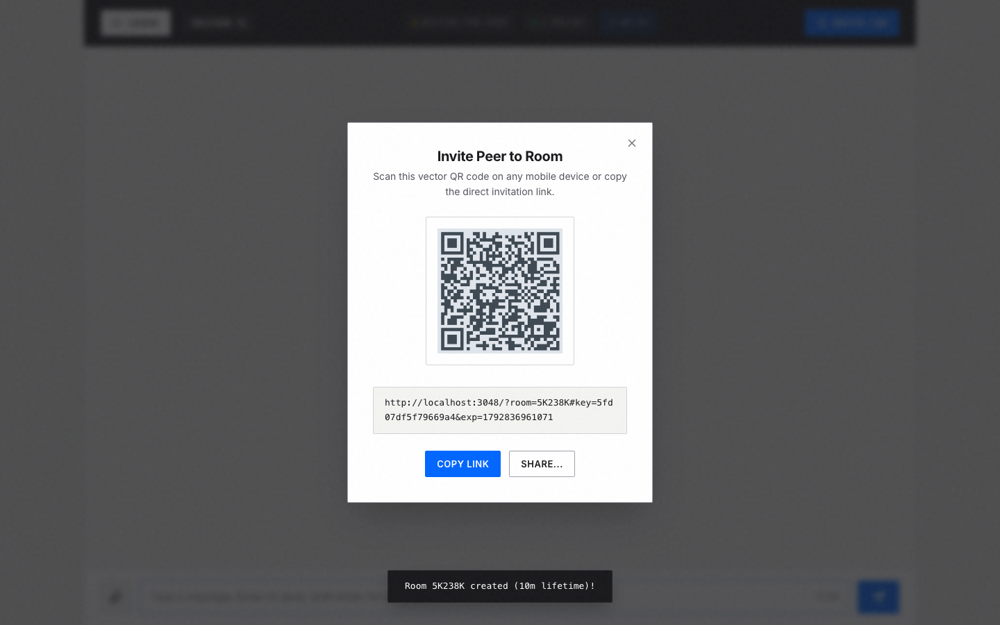
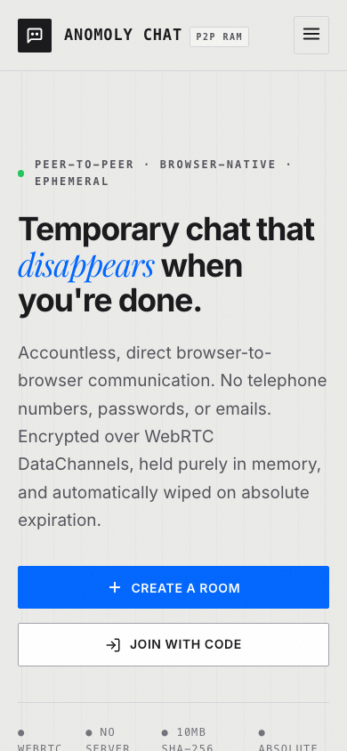

# Anomoly Chat

<p align="center">
  <strong>Temporary, accountless peer-to-peer chat & document sharing — directly between browsers.</strong><br />
  Built with WebRTC, native binary chunk streaming, SHA-256 integrity verification, and self-destructing rooms.
</p>

<p align="center">
  <a href="https://github.com/skandachandrashekar335-wq/anomoly-chat/actions/workflows/ci.yml">
    
  </a>
  <a href="LICENSE">
    
  </a>
  <a href="https://anomoly-chat.vercel.app">
    
  </a>
  <a href="src/index.test.ts">
    
  </a>
</p>

<p align="center">
  <a href="https://anomoly-chat.vercel.app"><strong>Live Web App</strong></a> ·
  <a href="docs/ARCHITECTURE.md"><strong>Architecture & Protocol</strong></a> ·
  <a href="docs/VERIFICATION.md"><strong>Verification Evidence</strong></a> ·
  <a href="SECURITY.md"><strong>Security & Privacy</strong></a> ·
  <a href="CONTRIBUTING.md"><strong>Contributing</strong></a> ·
  <a href="CHANGELOG.md"><strong>Changelog</strong></a>
</p>

---

## 📸 Application Preview

<p align="center">
  
</p>

---

## 🌟 At a Glance

- **No Registration or Sign-in**: Zero user accounts, passwords, phone numbers, or email addresses collected.
- **Direct Peer-to-Peer Chat**: Text messages move directly between browser nodes via WebRTC `RTCDataChannel` (DTLS encrypted).
- **Binary Document Transfer (Up to 10 MiB)**: Share PDF, Word, Excel, PowerPoint, Text, RTF, and OpenDocument files in **16 KiB binary chunks** via `ArrayBuffer` without Base64 inflation.
- **Cryptographic Integrity**: Received files are verified bit-for-bit against a sender-computed **SHA-256 digest** (`crypto.subtle.digest`) before the download link is enabled.
- **Dynamic Absolute Room Expiry**: Choose 5m (default), 10m, 15m, 20m, or custom 1–60 minutes. The countdown measures absolute time (`createdAt + lifetimeMs`), remaining impervious to message activity resets.
- **Creator-Controlled Extensions**: The room creator (Host) can authoritatively extend active rooms within a strict **4-hour lifetime ceiling**, synchronizing guest countdowns in real time without page reloads.
- **Client-Side QR Code Invitations**: QR codes are generated directly in the browser via `qrcode.min.js`.
- **URL Hash Privacy**: Session keys and expiration timestamps are stored exclusively in the URL fragment hash (`#key=...&exp=...`). Browsers **never send URL fragments in HTTP request headers or referrers**.
- **Warm Industrial UI**: Architectural design system featuring warm tactile surfaces (`#EBEBE8`), structural borders, subtle noise and architectural grid overlays, and electric blue accents, responsive across 1440px desktop, 768px tablet, and 390px mobile viewports.
- **Zero Server Storage**: Hosted as static assets on Vercel's Edge CDN. No central database storing chat history or file contents.

> [!NOTE]
> **Honest Privacy Notice**: "Anonymous" means no personal credentials or account identifiers are collected. It does **not** mean untraceable. WebRTC connections expose public IP addresses directly between connected peers, and signaling brokers observe connection metadata. Read [`SECURITY.md`](SECURITY.md) for full data flow details and threat model boundaries.

---

## 🌐 Live Application

**Production URL**: [https://anomoly-chat.vercel.app](https://anomoly-chat.vercel.app)

### Quick Walkthrough
1. **Create a Room**: Open the live application, select your preferred initial room duration, and click **Create Room Now**.
2. **Invite Peers**: Copy the room code or click **Invite / QR** to copy the secure invitation link or display the scannable QR code.
3. **Connect Directly**: Open the link in a second browser context, tab, or mobile device to establish a direct WebRTC DataChannel.
4. **Exchange Documents**: Click the paperclip button to attach any supported document up to 10 MiB. Both sender and receiver see live transfer progress and SHA-256 integrity verification.
5. **Extend Lifetime**: If you are the creator, click the live countdown timer pill to add +5m, +10m, +15m, +20m, or custom duration.

---

## 🏗️ Architecture Overview



For full sequence diagrams, protocol specifications, backpressure algorithms, and memory lifecycle details, see [`docs/ARCHITECTURE.md`](docs/ARCHITECTURE.md).

---

## 🖼️ Screenshot Gallery

| Desktop Conversation (`active-chat.png`) | Document Transfer & SHA-256 (`document-transfer.png`) |
| :---: | :---: |
|  |  |
| *Active room showing live countdown, P2P status, and bidirectional messages.* | *Document sharing card showing verified SHA-256 digest and download link.* |

| Room Creation Flow (`room-creation.png`) | Scannable QR Modal (`invite-qr.png`) | Mobile Viewport (`mobile-home.png`) |
| :---: | :---: | :---: |
|  |  |  |
| *Duration presets (5m, 10m, 15m, 20m, Custom).* | *In-browser generated QR code with URL hash.* | *Zero-overflow mobile layout (390px).* |

---

## 🛠️ Technology Stack

| Layer | Technology | Purpose & Rationale |
| :--- | :--- | :--- |
| **Frontend UI** | Vanilla HTML5, CSS3, ES2022 | Lightweight, zero-framework runtime with Warm Industrial design tokens. |
| **P2P Networking** | WebRTC `RTCDataChannel` | Direct peer-to-peer transport with DTLS transport encryption. |
| **Signaling** | `peerjs` (bundled static 85KB) | Brokers initial SDP offer/answer exchange via secure WebSockets. |
| **QR Generation** | `qrcode` (bundled static 24KB) | Fast, client-side vector/canvas QR generation without external APIs. |
| **Cryptography** | Web Crypto API (`crypto.subtle`) | Native browser SHA-256 digest calculation for binary document integrity. |
| **Testing** | Node.js Test Runner (`node:test`) | Built-in zero-dependency unit and protocol test suite (40 tests). |
| **Browser E2E** | Playwright Chromium | Headless browser smoke tests, responsive overflow checks, and screenshots. |
| **Hosting & CI** | Vercel CDN & GitHub Actions | Static edge hosting with automated CI on every push and pull request. |

---

## 🚀 Getting Started & Local Development

### Prerequisites
- **Node.js**: Version `22.x` or newer
- **npm**: Version `10.x` or newer
- **Git**

### Installation & Test Suite
```bash
# 1. Clone repository
git clone https://github.com/skandachandrashekar335-wq/anomoly-chat.git
cd anomoly-chat

# 2. Install dependencies reproducibly
npm ci

# 3. Typecheck TypeScript files
npm run typecheck

# 4. Run automated unit & protocol test suite (40 passing tests)
npm test

# 5. Run browser E2E smoke tests and screenshot capture
npx playwright install --with-deps chromium
npm run test:smoke
```

### Running Locally
```bash
# Run with included Express static development server (http://localhost:3000)
npm start
```
Or serve the static directory directly with any standard HTTP server:
```bash
npx serve public
```

---

## 🧪 Quality Assurance & Test Evidence

The repository maintains **40 automated tests** in [`src/index.test.ts`](src/index.test.ts):

- **Helper Functions (3 tests)**: 6-character room codes, ambiguous character avoidance (`0`, `O`, `I`, `l`), format validation.
- **Room Creation & Joining (4 tests)**: Code assignment, multiple participants, non-existent room handling, invalid character rejection.
- **Room-Scoped Isolation (1 test)**: Zero cross-room message leakage.
- **Validation & Rate Limiting (6 tests)**: Empty message rejection, 500-char cap, rapid-fire spam throttling, brute-force join rate limits.
- **Room Expiry & Cleanup (4 tests)**: Expired room lockout, memory sweep garbage collection, clean disconnects, SVG QR generation.
- **WebRTC Protocol Suite (7 tests)**: Preset durations, custom bounds (1–60m), absolute expiration math, URL hash fragment parsing, XSS textContent safety.
- **Feature 1 — Document Sharing Engine (10 tests)**: Empty file rejection, strict 10 MiB limit enforcement, allowlist validation (`.pdf`, `.docx`, `.xlsx`, `.txt`, `.rtf`, etc.), executable extension blocking, filename path traversal sanitization, 16 KiB chunk boundary calculations, SHA-256 binary reassembly verification, corrupted payload detection.
- **Feature 2 — Creator-Controlled Expiry Extension (5 tests)**: Presets (+5m, +10m, +15m, +20m), custom duration clamping (1–60m), expired room lockout, 4-hour lifetime ceiling enforcement, Host-only authorization validation.

For reproducible commands, checklists, and test limitations, see [`docs/VERIFICATION.md`](docs/VERIFICATION.md).

---

## 🔒 Security & Privacy Boundaries

Anomoly Chat is designed as an ephemeral, accountless tool. Please understand the real architectural boundaries:

1. **IP Exposure**: WebRTC establishes direct peer-to-peer UDP sockets. Your public IP address is inherently visible to the peer you connect with.
2. **Signaling Metadata**: While message contents never traverse the signaling server, the signaling broker observes public IP addresses and connection timestamps during the initial handshake.
3. **Firewalls & Symmetric NATs**: Direct peer connections work across most home and commercial Wi-Fi networks via STUN hole punching. Restrictive enterprise firewalls or symmetric carrier-grade NATs (CGNAT) may fail to connect without a dedicated TURN relay.
4. **Client-Side Expiry**: Room expiry and creator privileges are enforced in client code. A malicious participant can modify their local client environment. Do not use Anomoly Chat for adversarial communications.
5. **Local Download Persistence**: Once a file is downloaded by a peer to their local device filesystem, it cannot be remotely deleted.

For responsible vulnerability reporting, see [`SECURITY.md`](SECURITY.md).

---

## 🗺️ Roadmap

- [ ] Optional user-configurable TURN credentials for enterprise NAT traversal.
- [ ] Multi-peer mesh topologies (supporting 3+ simultaneous participants).
- [ ] End-to-end passphrase encryption layer on top of WebSockets for signaling data.
- [ ] Visual transfer progress pause/resume controls.

---

## 📄 License & Community

- **License**: Licensed under the [Apache License 2.0](LICENSE).
- **Contributing**: Please review [`CONTRIBUTING.md`](CONTRIBUTING.md) for development workflows and PR conventions.
- **Changelog**: Release history is tracked in [`CHANGELOG.md`](CHANGELOG.md).
- **Issues**: [Report a Bug](https://github.com/skandachandrashekar335-wq/anomoly-chat/issues/new?template=bug_report.md) or [Request a Feature](https://github.com/skandachandrashekar335-wq/anomoly-chat/issues/new?template=feature_request.md).
