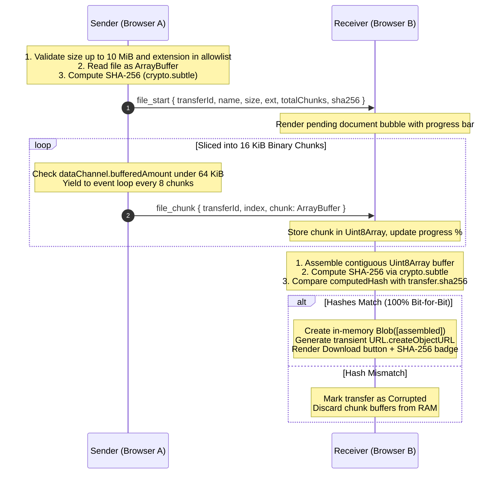
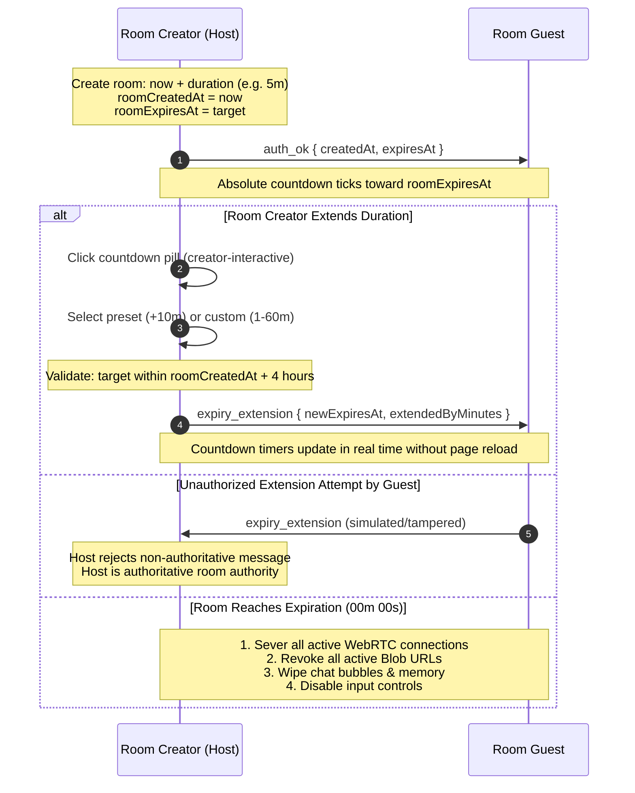

# Anomoly Chat — Technical Architecture

This document details the engineering architecture, network protocols, cryptographic verification, and data flow of **Anomoly Chat**.

---

## 1. High-Level Architecture Overview

Anomoly Chat is a **browser-first, serverless peer-to-peer web application**. Unlike traditional chat applications that route all messages through a persistent application server and message database, Anomoly Chat uses **WebRTC DataChannels** (`RTCDataChannel`) to transmit chat messages and document chunks directly between users' browsers.

```
┌────────────────────────────────────────────────────────────────────────┐
│                          Vercel Edge Network                           │
│              (Serves Static HTML5, CSS3, Bundled JS Assets)            │
└──────────────────────────────────┬─────────────────────────────────────┘
                                   │
              HTTP GET /           │ HTTP GET /
                                   ▼
        ┌─────────────────────────────────────────────────────┐
        │                  Browser A (Host)                   │
        │  - Generates 6-char Room Code & Session Key         │
        │  - Initializes WebRTC Peer (PeerJS)                 │
        │  - Computes In-Browser QR Code                      │
        └──────────────┬───────────────────────────▲──────────┘
                       │                           │
         ICE Exchange  │             Direct P2P    │  Direct P2P
        via WebSockets │          DTLS DataChannel │ DTLS DataChannel
                       ▼                           │
        ┌───────────────────────────────┐          │
        │ PeerJS Cloud Signaling Server │          │
        │       (0.peerjs.com:443)      │          │
        │   Brokers initial handshake   │          │
        └──────────────┬────────────────┘          │
                       │                           │
         ICE Exchange  │                           │
        via WebSockets │                           │
                       ▼                           │
        ┌──────────────────────────────────────────┴──────────┐
        │                  Browser B (Guest)                  │
        │  - Joins via Code or URL (#key=...&exp=...)         │
        │  - Receives Direct P2P Messages & Binary Chunks     │
        │  - Verifies SHA-256 Digest in Transient Memory      │
        └─────────────────────────────────────────────────────┘
```

---

## 2. Core Architectural Pillars

### A. Static Edge Deployment
- The application is hosted as static assets on **Vercel's Global Edge Network**.
- Zero backend application servers to maintain, scale, or patch.
- Zero server-side cold starts; static assets are cached globally.

### B. Signaling vs. Data Plane Separation
WebRTC requires **signaling** to exchange connection metadata (Session Description Protocol / SDP and Interactive Connectivity Establishment / ICE candidates):
- **Signaling Plane**: Brokered via the public PeerJS signaling service (`0.peerjs.com`) over secure WebSockets (`wss:`). The signaling server only brokers the initial handshake; it **never receives, relays, or stores chat messages or documents**.
- **Data Plane**: Once established, traffic moves over direct WebRTC DataChannels (`RTCDataChannel`) using **DTLS** (Datagram Transport Layer Security).

### C. URL Fragment Hash Privacy (`#key=...&exp=...`)
When a room creator shares an invitation link:
```
https://anomoly-chat.vercel.app/?room=7YQGPH#key=8cd389625ddcc5b2&exp=1792793045915
```
- The room code (`?room=...`) is an ordinary query parameter.
- The cryptographic session key (`key=...`) and expiration timestamp (`exp=...`) reside **strictly in the URL fragment hash** (`#`).
- Per RFC 3986 and browser standards, **browsers never send URL fragment hashes in HTTP request headers or HTTP referrers**. Web servers, CDN proxies, and intermediate networks never observe session secrets.

---

## 3. P2P Binary Document Transfer Engine

Anomoly Chat supports document sharing up to **10 MiB (10,485,760 bytes)** for common document formats (`.pdf`, `.doc`, `.docx`, `.txt`, `.rtf`, `.ppt`, `.pptx`, `.xls`, `.xlsx`, `.odt`, `.ods`, `.odp`).



### Key Engineering Decisions in File Transfer:
1. **Binary `ArrayBuffer` Transfer (No Base64 Inflation)**: Chunks are transferred directly as typed arrays. PeerJS uses BinaryPack serialization, avoiding the 33% memory and network overhead of Base64 encoding.
2. **16 KiB Chunk Slicing**: Slices files into 16,384-byte chunks, matching standard WebRTC SCTP packet buffer thresholds.
3. **Backpressure Throttling**: Monitors `dataChannel.bufferedAmount`. If the buffer exceeds 64 KiB, transmission pauses until it drains below 32 KiB. This prevents socket buffer exhaustion on asymmetric or slower connections.
4. **Transient RAM Lifecycle**: Downloadable files exist strictly as in-memory `Blob` URLs (`blob:https://...`). All Object URLs are registered in an `activeBlobUrls` set and **revoked immediately** when leaving the room or when room lifetime expires.

---

## 4. Room Expiry & Extension Architecture



### Expiry Rules & Safeguards:
1. **Absolute Expiration**: The countdown timer measures `remainingMs = roomExpiresAt - Date.now()`. Activity (sending messages or files) does not reset the room lifespan.
2. **Creator Authority**: The room creator (Host) holds exclusive extension rights. Guests have non-interactive countdown displays and cannot initiate extensions.
3. **4-Hour Maximum Lifetime**: `MAX_TOTAL_ROOM_LIFETIME_MS = 14,400,000 ms` prevents runaway rooms. Extensions that would push expiry past 4 hours from creation are automatically capped.
4. **Permanent Expiration Lockout**: Once `Date.now() >= roomExpiresAt`, all inputs lock and connections close. An expired room cannot be extended.

---

## 5. Security & Threat Model

| Threat Vector | Mitigation Strategy in Anomoly Chat |
| :--- | :--- |
| **XSS via Chat Text** | Safe DOM manipulation strictly using `.textContent`. Incoming peer text is never passed to `innerHTML`. |
| **Path Traversal via Files** | Filenames are sanitized with regex stripping `../`, `..\`, control chars, null bytes, and non-printable tokens. |
| **Malicious Executable Files** | Strict allowlist restricted to document formats (`.pdf`, `.docx`, `.xlsx`, `.pptx`, `.txt`, `.rtf`, `.odt`, `.ods`, `.odp`). `.exe`, `.sh`, `.bat`, `.js`, `.py`, `.html` are rejected. |
| **Data In-Flight Interception** | Transport encryption enforced via WebRTC standard DTLS/SRTP cryptography. |
| **Data At-Rest Compromise** | Zero server persistence. Zero application database. Messages and files reside solely in volatile browser RAM. |
| **Session Key Leakage** | Session secret and expiration are placed in the URL fragment (`#hash`), preventing transmission in HTTP request headers. |
| **Room Flooding / Spam** | Client-side rate limiting (max 5 actions per 2-second sliding window). |

---

## 6. Honest Network Limitations

1. **NAT & Firewall Traversal (STUN vs. TURN)**:
   - Anomoly Chat uses public Google STUN servers (`stun:stun.l.google.com:19302`) to resolve public IP and port mappings.
   - Symmetric NATs (common in enterprise firewalls and mobile carrier-grade NATs) prevent direct UDP hole punching. Without a TURN relay, direct connections between symmetric NATs cannot succeed.
2. **Metadata Exposure**:
   - The public PeerJS signaling service sees connection timestamps and public IP addresses during the handshake.
   - Once direct P2P is established, each peer's public IP address is visible to the other connected peer in the WebRTC candidate exchange.
3. **Client-Side Enforcement**:
   - Because there is no persistent central server verifying room rules, a modified client can alter local JavaScript execution. The application provides accountless, ephemeral privacy for trusted peers, not adversarial defense.
